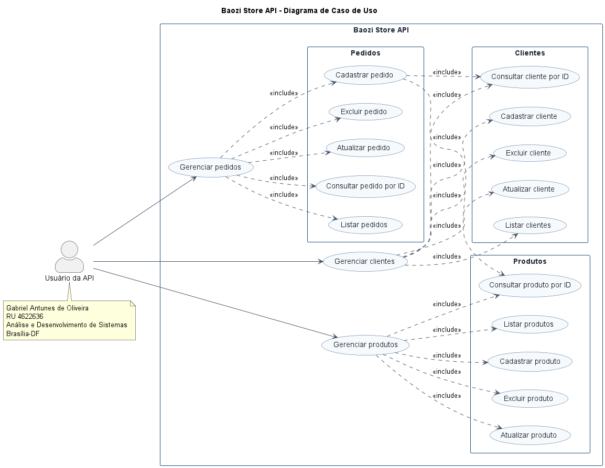

# Baozi Store API

API REST para gerenciamento de clientes, produtos e pedidos de uma pequena loja de baozi, desenvolvida com Java, Spring Boot e Spring Data JPA.

## Sobre o projeto

A Baozi Store API foi desenvolvida como atividade prática do curso de Análise e Desenvolvimento de Sistemas.

A aplicação permite cadastrar, consultar, atualizar e excluir clientes, produtos e pedidos. Cada pedido é associado a um cliente e a um produto. O valor total é calculado automaticamente com base no preço e na quantidade solicitada.

## Funcionalidades

### Clientes

- Cadastrar cliente
- Listar clientes
- Consultar cliente por ID
- Atualizar cliente
- Excluir cliente

### Produtos

- Cadastrar produto
- Listar produtos
- Consultar produto por ID
- Atualizar produto
- Excluir produto

### Pedidos

- Cadastrar pedido
- Listar pedidos
- Consultar pedido por ID
- Atualizar pedido
- Excluir pedido
- Associar pedido a cliente e produto
- Calcular automaticamente o valor total
- Impedir pedidos de produtos indisponíveis

## Tecnologias utilizadas

- Java 17
- Spring Boot 4.0.8
- Spring Web MVC
- Spring Data JPA
- Jakarta Validation
- Hibernate
- H2 Database
- Maven
- Postman
- PlantUML
- Git e GitHub

## Arquitetura

A aplicação foi organizada em camadas:

```text
src/main/java/br/com/gabrielantunes/baozistore/
├── controller/
├── dto/
├── model/
├── repository/
├── service/
└── BaoziStoreApiApplication.java
```

- `controller`: disponibiliza os endpoints REST.
- `dto`: recebe dados específicos das requisições.
- `model`: representa as entidades persistidas.
- `repository`: realiza o acesso aos dados.
- `service`: concentra as regras de negócio.

## Diagrama de caso de uso



O arquivo-fonte em PlantUML está em `docs/diagrams/caso-de-uso.puml`.

## Endpoints

### Clientes

| Método | Endpoint | Operação |
|---|---|---|
| POST | `/api/clientes` | Cadastrar cliente |
| GET | `/api/clientes` | Listar clientes |
| GET | `/api/clientes/{id}` | Consultar cliente por ID |
| PUT | `/api/clientes/{id}` | Atualizar cliente |
| DELETE | `/api/clientes/{id}` | Excluir cliente |

### Produtos

| Método | Endpoint | Operação |
|---|---|---|
| POST | `/api/produtos` | Cadastrar produto |
| GET | `/api/produtos` | Listar produtos |
| GET | `/api/produtos/{id}` | Consultar produto por ID |
| PUT | `/api/produtos/{id}` | Atualizar produto |
| DELETE | `/api/produtos/{id}` | Excluir produto |

### Pedidos

| Método | Endpoint | Operação |
|---|---|---|
| POST | `/api/pedidos` | Cadastrar pedido |
| GET | `/api/pedidos` | Listar pedidos |
| GET | `/api/pedidos/{id}` | Consultar pedido por ID |
| PUT | `/api/pedidos/{id}` | Atualizar pedido |
| DELETE | `/api/pedidos/{id}` | Excluir pedido |

## Exemplos de requisições

### Cadastrar cliente

```json
{
  "nome": "Gabriel4622636",
  "clienteDesde": "2026-10-07"
}
```

### Cadastrar produto

```json
{
  "nome": "Baozi Tradicional",
  "preco": 12.90,
  "estoque": true
}
```

### Cadastrar pedido

```json
{
  "clienteId": 2,
  "produtoId": 2,
  "quantidade": 4
}
```

## Regras de negócio

- O nome do cliente é obrigatório.
- A data de cadastro não pode estar no futuro.
- O nome e o preço do produto são obrigatórios.
- O preço deve ser maior que zero.
- A quantidade do pedido deve ser maior que zero.
- Cliente e produto precisam existir.
- O produto precisa estar disponível em estoque.
- O valor total é calculado automaticamente.
- Cadastros retornam `201 Created`.
- Consultas retornam `200 OK`.
- Exclusões retornam `204 No Content`.
- Recursos inexistentes retornam `404 Not Found`.

## Como executar

### Pré-requisitos

- Java 17 ou superior
- Git

### Clonar o repositório

```bash
git clone https://github.com/gdeoliveiradev/baozi-store-api.git
cd baozi-store-api
```

### Executar no Windows

```powershell
.\mvnw.cmd spring-boot:run
```

A aplicação ficará disponível em `http://localhost:8080`.

## Banco de dados H2

Console: `http://localhost:8080/h2-console`

- Driver: `org.h2.Driver`
- JDBC URL: `jdbc:h2:file:./data/baozistore`
- Usuário: `sa`
- Senha: deixar em branco

## Coleção do Postman

A coleção está disponível em `docs/postman/Baozi Store API.postman_collection.json`.

Para importar:

1. Abra o Postman.
2. Clique em `Import`.
3. Selecione o arquivo da coleção.
4. Inicie a aplicação.
5. Execute as requisições.

Para exclusão, use esta ordem:

1. Pedido
2. Produto
3. Cliente

## Autor

**Gabriel Antunes de Oliveira**

- RU: 4622636
- Curso: Análise e Desenvolvimento de Sistemas
- Cidade: Brasília-DF
- GitHub: https://github.com/gdeoliveiradev

## Contexto acadêmico

Projeto desenvolvido como atividade prática do módulo de Desenvolvimento Web Back-End.

## Licença

Este projeto utiliza a licença MIT. Consulte o arquivo `LICENSE`.
